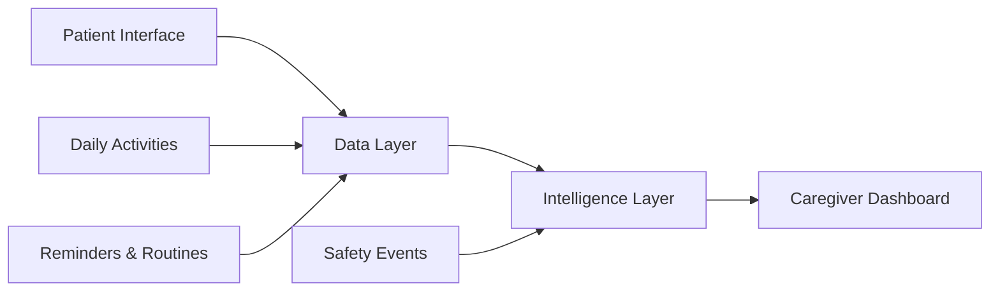

# CogniCare 🩵
### Making dementia care more human, connected and consistent.

[](https://memory-lane-jet.vercel.app/)

CogniCare is a dementia-care companion designed to support people living with dementia in their everyday routines while helping caregivers stay informed and connected.

The platform brings together reminders, meaningful engagement activities, memory sharing, voice assistance and safety features in one accessible experience.

Built as a functional, interactive prototype, CogniCare explores how thoughtful technology can support patient independence and reduce the everyday monitoring burden on caregivers.

**Live application:** https://memory-lane-jet.vercel.app/

---

## ✨ Key Features

CogniCare provides two distinct experiences designed around the needs of patients and caregivers.

### 🧑‍🦳 Patient Experience

- **Daily Companion:** A simple home screen with a personalised greeting and upcoming activities.
- **Smart Reminders:** View daily medicine reminders and routines, mark tasks as completed or snooze them.
- **Task Management:** Add, edit and manage daily tasks.
- **Voice Assistant – Ask me:** Interact through voice or accessible tappable commands.
- **Memory Album:** Revisit meaningful memories through photographs, descriptions and narration.
- **Interactive Games:** Three engagement activities designed to encourage cognitive participation:
  - Matching Pairs
  - Spot the Difference
  - Picture Puzzle
- **SOS Assistance:** A persistent SOS action that opens an assistance experience and alerts the caregiver interface in the prototype.
- **Location Sharing:** Explicitly consent-based location sharing with safety-zone and geofencing demonstrations.

### 👩‍⚕️ Caregiver Experience

- **Caregiver Dashboard:** An overview of patient activities and engagement.
- **Task Management:** Create, edit and manage patient reminders and daily routines.
- **Engagement Insights:** Review activity history and engagement patterns.
- **Location Safety:** View available patient location information, safety-zone status and location history.
- **SOS Alerts:** View, acknowledge and resolve patient assistance alerts.

---

## 🧠 How It Works

CogniCare follows a modular architecture consisting of four major layers.

| Layer | Responsibility |
|---|---|
| Frontend | Patient and caregiver interfaces |
| Data Layer | Patient activity, reminders and engagement records |
| Intelligence Layer | Rule-based activity analysis and safety alerts |
| Dashboard | Daily summaries, activity trends and caregiver visibility |

The prototype demonstrates how activity and reminder data can flow through the system to generate useful information for caregivers.

### System Workflow



---

## 🛠️ Technology Stack

### Frontend Development

- **React.js** – Component-based application development.
- **JavaScript** – Application logic and interactions.
- **Vite** – Development server and production build tooling.
- **Tailwind CSS** – Styling and responsive layouts.
- **Motion for React** – UI animations and transitions.

### Integrations & Functionality

- **Leaflet.js** – Interactive maps and location visualisation.
- **OpenStreetMap** – Map tiles and geographical information.
- **Browser Speech APIs** – Speech recognition and text-to-speech functionality.
- **Browser Geolocation API** – Consent-based device location access.
- **Rule-based logic** – Reminder handling, activity analysis and safety monitoring.
- **OGL** – WebGL-based carousel visual effects.

### Development & Deployment

- **Claude Code** – AI-assisted development and implementation.
- **Google Antigravity** – AI-assisted development workflow.
- **Figma** – UI/UX design and prototyping.
- **Git & GitHub** – Version control and team collaboration.
- **Playwright** – Browser testing.
- **Oxlint** – Code linting.
- **Vercel** – Application deployment.

---

## 🚀 Getting Started

Follow these steps to run CogniCare locally.

### Prerequisites

Make sure you have installed:

- Node.js (LTS recommended)
- npm
- Git

### 1. Clone the repository

```bash
git clone https://github.com/devyanimahalle/Memory-Lane.git
```

### 2. Navigate to the project

```bash
cd Memory-Lane
```

### 3. Install dependencies

```bash
npm install
```

### 4. Start the development server

```bash
npm run dev
```

Open the local URL displayed in your terminal, usually:

```text
http://localhost:5173/
```

### 5. Create a production build

```bash
npm run build
```

### 6. Run lint checks

```bash
npm run lint
```

---

## 🧪 Prototype Scope & Limitations

CogniCare is a functional prototype intended to demonstrate the product experience and technical feasibility.

Some capabilities are simulated or browser-local and should not be interpreted as production-ready healthcare infrastructure.

| Feature | Current implementation |
|---|---|
| Patient and caregiver interfaces | Functional frontend |
| Reminders and routines | Browser-local prototype logic |
| Activity analytics | Simulated activity data and rule-based analysis |
| SOS alerts | Same-browser, same-origin simulation |
| Location sharing | Browser geolocation with explicit patient consent |
| Geofencing | Rule-based safety-zone demonstration |
| Voice assistant | Browser speech capabilities, subject to browser support and permission |
| Data persistence | Browser-local storage where implemented |
| Cross-device synchronisation | Not implemented |
| Backend authentication | Not implemented |
| Real push/SMS notifications | Not implemented |
| Medical diagnosis | Not supported |

### Important Safety & Privacy Notes

- Location sharing does not start automatically. Patient consent is required.
- Location information represents the device running the patient interface.
- SOS alerts are simulated within the same browser origin and do not send real emergency notifications.
- Browser speech recognition may rely on an external browser speech service.
- The application is not a substitute for professional medical care or emergency services.
- The current prototype should use demonstration data rather than real patient medical information.

---

## 🎨 Design Principles

CogniCare is designed around the following principles:

- **Simplicity:** Reduce cognitive load through clear layouts and straightforward interactions.
- **Familiarity:** Use recognisable patterns, routines and meaningful memories.
- **Accessibility:** Prioritise readable typography, large touch targets and simple language.
- **Independence:** Help patients participate in everyday activities with greater confidence.
- **Caregiver Support:** Make relevant information easier to understand without encouraging constant surveillance.
- **Human-centred Technology:** Use technology to complement human care, not replace it.

---

## 🔮 Future Scope

Potential areas for further development include:

- Secure backend infrastructure and authentication.
- Cross-device patient-caregiver synchronisation.
- Secure cloud-based patient activity records.
- Real-time caregiver notifications with appropriate consent.
- More personalised engagement recommendations.
- Expanded multilingual voice interactions.
- Improved accessibility and personalisation.
- Privacy-preserving activity pattern analysis.

---

## 👥 Team & Acknowledgements

Built collaboratively as a hackathon project.

The project brings together product design, frontend development, application logic, integrations and analytics to explore a more supportive approach to dementia care.

---

## 📄 Disclaimer

CogniCare is an experimental prototype created for demonstration and educational purposes. It is not a certified medical product, diagnostic tool or emergency response service.

---

<p align="center">
  **CogniCare — Care that feels connected. 🩵**
</p>
